

  

  
  
  
  
  
  
  

I build machine-learning systems end to end, with a focus on **language models, retrieval and trustworthy answers**.
I measure what works: baselines, honest metrics and documented limitations.

## Featured projects

  <a href="https://github.com/Corrosifu/RAG_Fact_Checking"></a>
  <a href="https://github.com/Corrosifu/Spam_Detection"></a> 
  <a href="https://github.com/Corrosifu/Projet_MLA"></a>
  <a href="https://github.com/Corrosifu/covid19_diagnosis"></a>

---

<h2></h2>

Small local language models write fluent answers that are sometimes not backed by their sources. This system answers questions about scientific papers **and shows which sentences of the answer are confirmed by the evidence**.

  
  
  
  
  

  <a href="img/rag-architecture.png">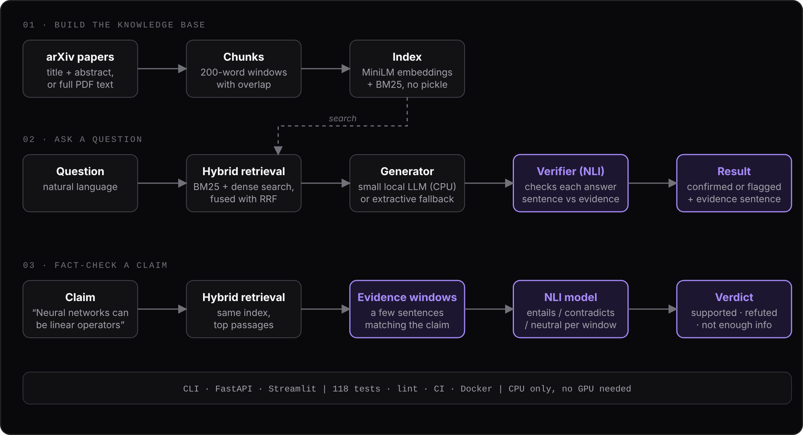</a>

**See it work** — a faithful answer confirmed, then a partly invented one flagged:

  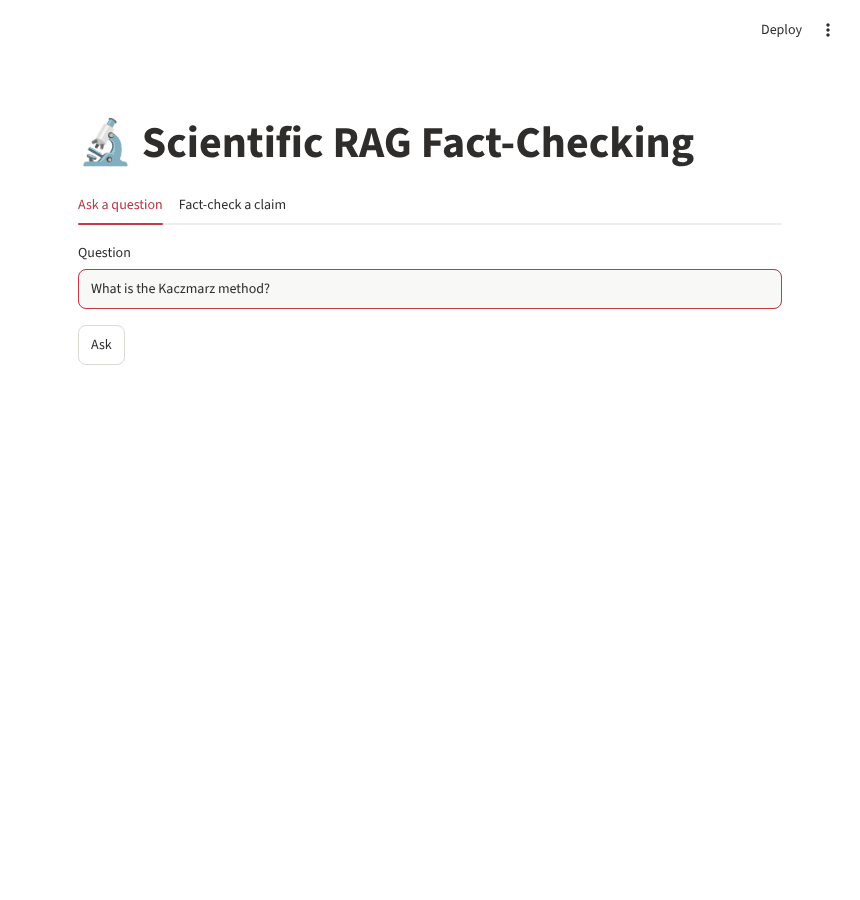

  <a href="img/rag-fact-check.png">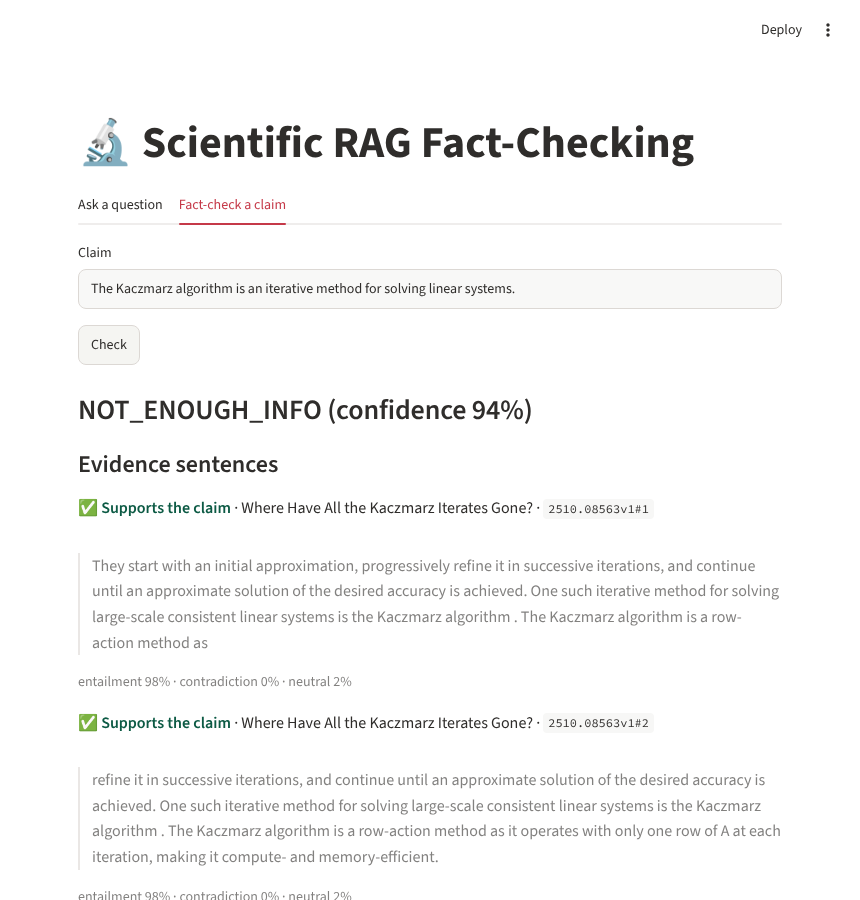</a>

**What testing on real papers taught me**

- Feeding whole PDF chunks to the NLI model produced confident wrong verdicts (a true claim refuted at 84 %); sentence-level evidence windows removed them.
- A single bibliography entry can break a verdict: with neural retrieval, a true claim came out inconclusive because a reference entry (title, journal, pages, year) was retrieved and the NLI model scored it 0.92 contradiction. References are now removed before indexing (616 to 476 chunks on my 10-paper corpus) and the verifier skips bibliography-like sentences. It is a heuristic tuned on that corpus.
- On a 0.5B generator, the verifier flagged 5 of 6 sentences of a partly invented answer and confirmed 2 of 2 of a faithful one. Hand-checked samples, not a benchmark: next step is a public claim-verification dataset.

[**→ Repository, documentation and limitations**](https://github.com/Corrosifu/RAG_Fact_Checking)

<b>Results at a glance</b> — spam detection, COVID-19 prediction and adversarial ML

 

<h3></h3>

  
  

(CEAS-08, 4,000-email sample, single 80/20 split — caveats in the repository)

| Model | F1 (text only) | F1 (text + extra features) |
|---|---|---|
| KNN | 0.80 | 0.76 |
| Logistic regression | 0.98 | 0.97 |
| Random forest | 0.98 | 0.99 |
| XGBoost | 0.98 | 0.98 |
| DistilBERT (fine-tuned from a spam-tuned checkpoint) | 0.995 | 0.996 |

  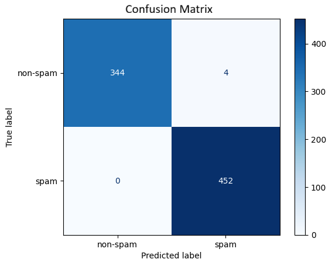 
  DistilBERT on 800 test emails: no spam missed, 4 legitimate emails flagged.

<h3></h3>

  
  

(Hospital Israelita Albert Einstein data): accuracy 0.909 · recall 0.706 · AUC 0.824 · KS 0.648. Limits: small test set, heavy missingness, no external validation.

  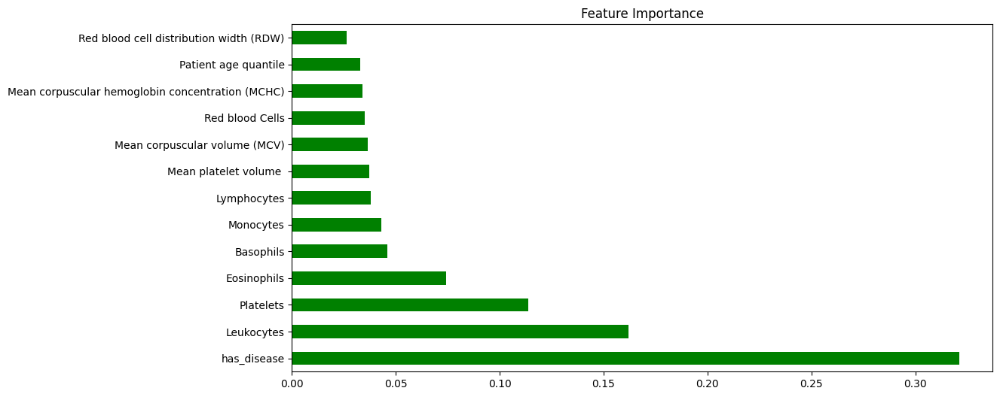

<h3><a href="https://github.com/Corrosifu/Projet_MLA"></a></h3>

  
  

(MNIST, `eps = 0.25`, [reproduction of Goodfellow et al. 2015](https://github.com/Corrosifu/Projet_MLA)): adversarial training lowers the error of a maxout network on FGSM examples from 91.9 % to 10.8 % (paper: 89.4 % to 17.9 %), but a 20-step PGD attack still reaches **98.2 %**. The model mostly learned to resist the attack it was trained on. One seed, untuned recipe; the repository lists what is and is not reproduced.

---

## Stack

**AI & ML** &nbsp;        

**Backend & MLOps** &nbsp;      

**Cloud & DevOps** &nbsp;    

## Experience

-  **Sanofi** · data scientist (current).
- 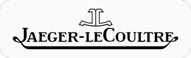 **Jaeger-LeCoultre** · data science intern (2023) — supply-chain demand forecasting (XGBoost, Random Forest, LSTM on BigQuery and SQL Server); improved the weighted MAPE by **45 %** compared with the business teams' own forecasts.
-  **Sorbonne Université** · research intern (2022) — reinforcement learning for autonomous parking: LQR, DDPG and DQN controllers in HighwayEnv.
- **TurtleBot autonomous racing** (2022) — ROS and Gazebo, LIDAR/camera/IMU, OpenCV colour detection, PID tuning.

## Education

-  **Mastère Spécialisé Data & Generative AI Engineering** — EFREI (in progress)
-   **MSc Robotics & Artificial Intelligence (SAR)** — Sorbonne Université, 2023, joint programme with ENSAM (Arts et Métiers)
